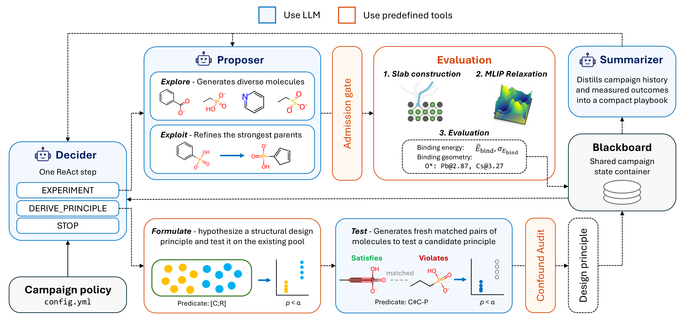

# PerovAgent for Autonomous Discovery of Ligand Design Principles for Halide Perovskite Surfaces



This repository contains the source codes for our work below:

Cha, S; Jeong, YJ; Conde del Moral, A; Correa-Baena, J-P; Marder, S; Ginger, D*; Fung, V*; Hu, G*. **Autonomous Discovery of Ligand Design Principles for Halide Perovskite Surfaces.**

If you have any questions regarding this repository, create an issue or contact scha@gatech.edu.

## Installation

A CUDA GPU is required (`relaxer.device: cuda` in the configs).

```bash
# create virtual environment
conda create -n "YOUR_ENV" python=3.12
conda activate "YOUR_ENV"

# clone the repository
git clone https://github.com/Hu-group-at-GT/PerovAgent.git
cd PerovAgent
pip install -e .

# download DFT-D3 cache files
python -m perovagent.evaluation.dftd3
```

## Run the discovery campaign

### 1. Configure the `config.yml`

The config files used in our work can be found in `./config`. Modify as needed. The LLM is set by `campaign.model` and `campaign.reasoning_effort`.

### 2. Locate the API key

`PerovAgent` currently only supports `OPENAI_API_KEY`; support for other LLM providers is in progress. To use the key, create an `.env` file in any directory with the following format:

```bash
# .env 
export OPENAI_API_KEY="YOUR_API_KEY"
```

Then, load the key by running:
```bash
set -a; source .env; set +a
```

### 3. Start the campaign

The campaign budget and parallelization setting must be set by CLI arguments. Note that each campaign can only use a single GPU, so set `gpu` id only when you are running multiple campaigns in parallel on a multi-GPU machine. 

```bash
python run_discovery_campaign.py --config config/config.yml \
                                 --output_dir OUTPUT_DIR \
                                 --n_workers 4 \
                                 --gpu 0 \
                                 --random_seed 42 \
                                 --evals_cap 200 \
                                 --iters_cap 150 \
                                 --patience 0
```

- `--n_workers`: parallel MLIP workers
- `--gpu`: GPU id
- `--evals_cap`, `--iters_cap`: budget by # of molecules, # of ReAct steps
- `--patience`: early stopping (0 disables it)


## Campaign outputs


| File | Contents |
|---|---|
| `config.json` | the config plus the resolved CLI arguments the run used |
| `summary.json` | best-binding ligand, principle counts, stop reason |
| `decision_log.jsonl`, `convergence.jsonl` | one row per ReAct step: the decision, its result, pool statistics |
| `candidates.jsonl` | every evaluated ligand: SMILES, anchor, binding energy ± placement spread, contact map, hypothesis |
| `principles.jsonl` | the design principle ledger: every principle with its verdict and confound audit |
| `anchors.jsonl` | the anchor definitions registered during the run |
| `rejected_log.jsonl`, `rejected_log.md` | every proposal that was rejected |
| `reasoning_log.md` | per-iteration Decider reasoning and every evaluated molecule's hypothesis and outcome |
| `playbook_log.md` | per-iteration playbook the Summarizer distilled |
| `token_log.jsonl` | LLM token usage per iteration |
| `observations/` | the exact observation the Decider received at each iteration |
| `perovkit_eval/` | relaxed geometries of slabs and ligands |


## Terminology: paper vs code

To improve clarity and readability, some terminologies in the paper have been changed from those used in the code. We did not reflect these changes *post hoc* because this changes the raw text that agents see, which could potentially affect their search behaviors and hence the reproducibility of this work. This repository exactly maintains the old prompts and schemas of the campaigns reported in the paper. 

| Paper | Code, and what the agents see |
|---|---|
| *Formulate* | prompts say `DERIVE_PRINCIPLE`; `retrospective` in variable names |
| *Test* | prompts say `EXPERIMENT` with `goal="explain"`; `prospective` in variable names |
| satisfying / violating group | prompts say "arm"; principle fields `n_match` / `n_other` |
| matched molecular pair | prompts and verdict details say "twin" |
| independent unit (after Butina clustering) | verdict details say "series"; principle fields `n_match_eff` / `n_other_eff` |
| playbook | Summarizer prompt says lessons; `EditLesson`|
| confound audit: partition balance, anchor confounding, separability, size confounding | principle fields `degenerate_partition`, `within_anchor_effect`, `anchor_perfectly_collinear`, `within_size_effect`.|

## License

MIT (see `LICENSE`). `src/perovagent/evaluation/dftd3.py` is adapted from NVIDIA
nvalchemi-toolkit-ops and remains under Apache-2.0 (see its header).